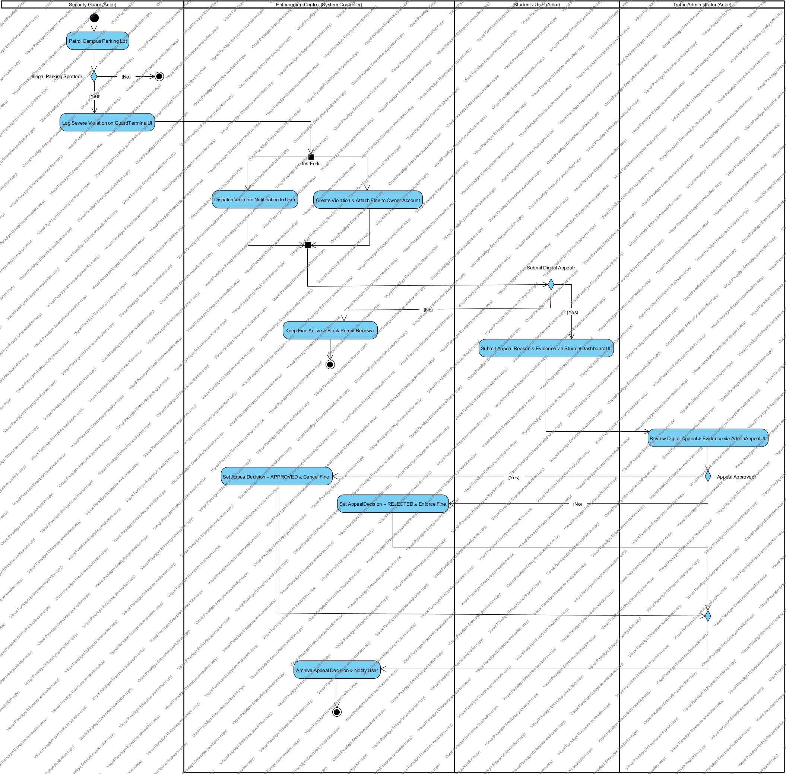
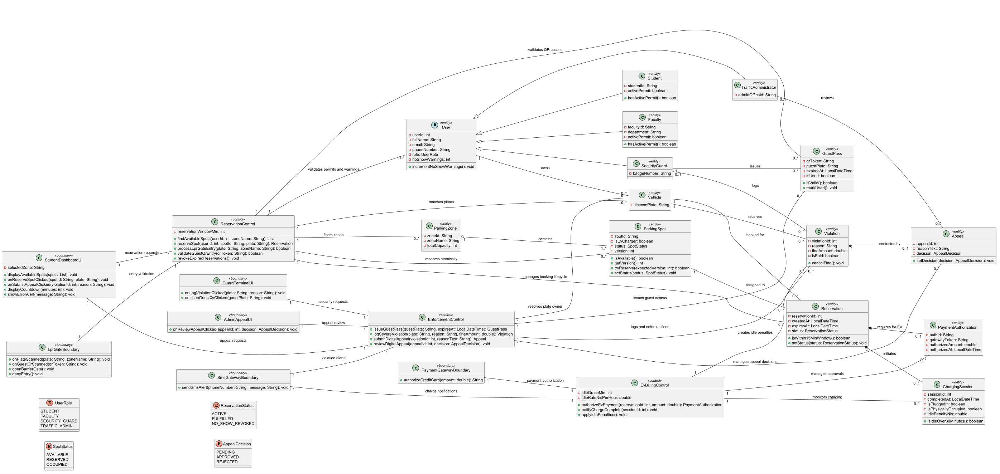
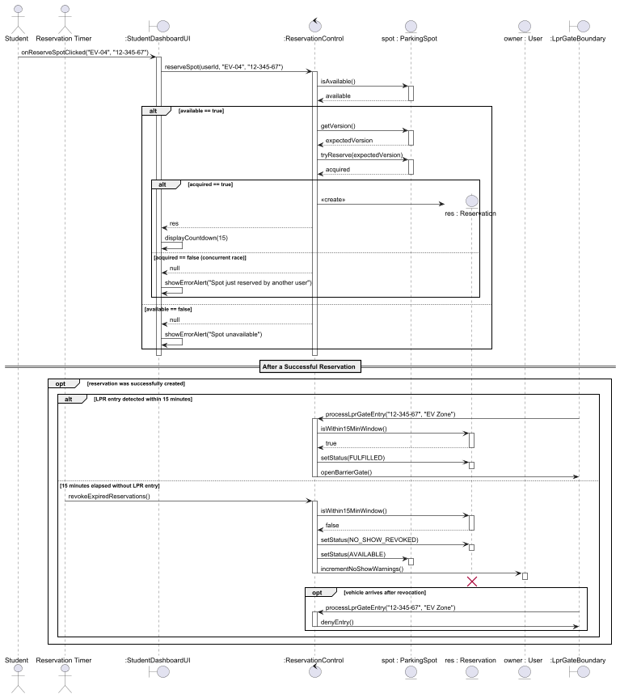

# System Architecture & Object-Oriented Design (`Ex4_SmartParking_Design`)

**Course:** 61756 Software Engineering Methods (Academic Year 2026-2027)
**Institution:** ORT Braude College of Engineering | Department of Software Engineering
**Domain:** Smart Campus Parking, LPR, and EV Network (Continued from Exercise 1)

---

## 1. Engineering Team Details

| Role | Full Name | Student ID | Braude Academic Email |
| :--- | :--- | :--- | :--- |
| **Student A (Role A)** | `Oriyan Eliguev` | `325424166` | `[Oriyan.Eliguev@e.braude.ac.il]` |
| **Student B (Role B)** | `ilya kaganovski` | `320533490` | `ilya.kaganvski@e.braude.ac.il` |

* **Group Number:** `G[04]`
* **GitHub Repository URL:** `https://github.com/oriyan1/Ex4_SmartParking_Design.git`

---

## 2. Step 1: Business Process Modeling — Activity Diagram (`Visual Paradigm`)

* **PlantUML Source:** [`diagrams/activity_appeal.puml`](diagrams/activity_appeal.puml)
* **Visual Paradigm Model:** [`SystemModel_Ex4.vpp`](SystemModel_Ex4.vpp)
* **Partitions / Swimlanes:** Separates external **Actors** (`Security Guard`, `Student / User`, `Traffic Administrator`) from the internal **System Controller** (`EnforcementControl`), using `initial node`, `fork`/`join` (AND), `decision` (XOR) with explicit `[guards]`, `merge` (OR), and `activity final node`.



---

## 3. Step 2: Structural Modeling — ECB Class Diagram (`PlantUML` -> `Visual Paradigm`)

Following the **ECB (Entity-Control-Boundary)** architectural pattern:

| ECB Stereotype | Classes in System | Architectural Responsibility |
| :--- | :--- | :--- |
| **`<<boundary>>`** | `StudentDashboardUI`, `GuardTerminalUI`, `AdminAppealUI`, `LprGateBoundary`, `PaymentGatewayBoundary`, `SmsGatewayBoundary` | Interfaces with external Actors and external hardware/payment/SMS systems. Communicates ONLY with `<<control>>` classes. |
| **`<<control>>`** | `ReservationControl`, `EvBillingControl`, `EnforcementControl` | Multiple specialized controllers orchestrating business rules, timers, concurrency checks, and workflows. |
| **`<<entity>>`** | `User` (`Student`, `Faculty`, `SecurityGuard`, `TrafficAdministrator`), `GuestPass`, `Vehicle`, `ParkingZone`, `ParkingSpot`, `Reservation`, `PaymentAuthorization`, `ChargingSession`, `Violation`, `Appeal` + 4 UML `enum`s | Passive domain data classes storing persistent business state and domain helper methods. |

* **PlantUML Source (revised after Part 4):** [`diagrams/class_diagram_ecb_part4_revised.puml`](diagrams/class_diagram_ecb_part4_revised.puml)
* **Visual Paradigm Model:** [`SystemModel_Ex4.vpp`](SystemModel_Ex4.vpp)



---

## 4. Step 3: Behavioral Modeling — ECB Sequence Diagrams (`PlantUML` -> `Visual Paradigm`)

### 4.1 Sequence Diagram 1: Spot Reservation, LPR Gate Entry & No-Show Destruction
* **PlantUML Source (revised after Part 4):** [`diagrams/sequence_reservation_ecb_part4_revised.puml`](diagrams/sequence_reservation_ecb_part4_revised.puml)



### 4.2 Sequence Diagram 2: EV Charging 30-Minute Idle Penalty (`loop` & `<<create>>`)
* **PlantUML Source:** [`diagrams/sequence_idle_penalty_ecb.puml`](diagrams/sequence_idle_penalty_ecb.puml)


---

## 5. Independent AI Prompt & Architectural Design Critique (Part 4)

```text
We designed a Smart Campus Parking System using ECB Class and Sequence Diagrams.

Please review our system design based on the attached SYSTEM_STORY.md, class_diagram_ecb.puml, and sequence_reservation_ecb.puml files.

We want you to check two important edge cases:

**1. Double Booking (Race Condition)**

Two students try to reserve the last available parking spot in the Student Zone at exactly the same time.

- Does our system prevent both students from reserving the same spot?
- Are the `version` attribute and `tryReserve(expectedVersion)` method used correctly?
- What happens to the student whose reservation fails?

**2. EV Charging and Physical Occupancy**

An electric vehicle finishes charging, and the driver disconnects the charging cable after 29 minutes but leaves the car in the parking spot.

- Will the system still apply the penalty after 30 minutes?
- Does the system correctly distinguish between `isPluggedIn` and `isPhysicallyOccupied`?
- How can we make sure the penalty continues until the vehicle physically leaves the parking spot?

**Design Review**

Please identify any problems or missing details in our Class and Sequence Diagrams.

Suggest at least one additional improvement to make our system more reliable, beyond the two required edge cases.

For each problem or improvement, explain:

- What the problem is.
- Why it matters.
- Which classes, attributes, methods, or Sequence Diagram messages should be updated.
- How we can implement the correction in our UML diagrams.

Please keep your explanations clear and practical, and distinguish between features that already exist in our design and features that need to be added.
```

**Edge Case A - Double Booking:**
The design uses a version counter and `tryReserve(expectedVersion)` to prevent two users from reserving the same parking spot. We added an explicit `getVersion(): int` method to `ParkingSpot` and updated Sequence Diagram 1 to read the expected version before the atomic reservation attempt. Only one concurrent attempt should succeed.

**Edge Case B - EV Physical Occupancy:**
The `ChargingSession` class separates `isPluggedIn` from `isPhysicallyOccupied`. The idle penalty must depend on the physical occupancy of the parking spot after the 30-minute grace period, even if the charging cable has been disconnected. The EV idle-penalty sequence must also be verified against this rule.

**Additional AI Improvement - Automatic No-Show:**
We added a `Reservation Timer` to Sequence Diagram 1 that invokes `revokeExpiredReservations()` after 15 minutes if no LPR entry has been detected. The controller changes the reservation status to `NO_SHOW_REVOKED`, releases the parking spot by setting its status to `AVAILABLE`, increments the owner's `noShowWarnings` counter, and destroys the expired reservation instance. This prevents expired reservations from blocking available parking spots.

---

## 6. License
Distributed under the **ORT Braude College Academic License** (61756 Software Engineering Methods, 2026-2027).
